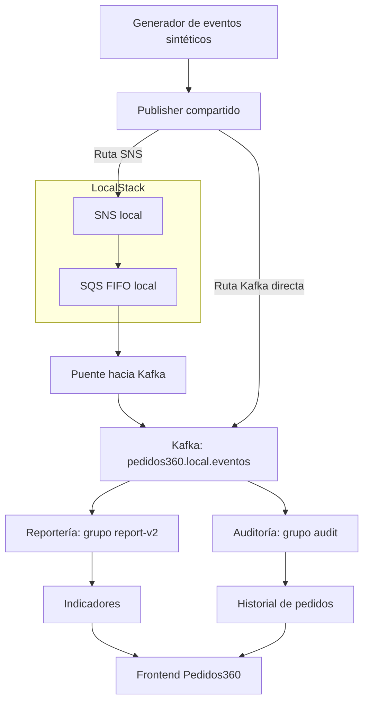

# Pedidos360

### Plataforma de pedidos con arquitectura orientada a eventos

Pedidos360 es un proyecto que integra una aplicación de pedidos con un flujo asíncrono de mensajería para reportería y auditoría.

La solución permite generar y publicar eventos, observar su recorrido por la infraestructura y consultar sus resultados desde una interfaz web. El entorno de demostración se ejecuta localmente mediante Docker e integra Apache Kafka, ZooKeeper, servicios SNS y SQS emulados con LocalStack y autenticación con Microsoft Entra ID.

---

## Tabla de contenidos

- [Objetivos](#objetivos)
- [Arquitectura](#arquitectura)
- [Tecnologías utilizadas](#tecnologías-utilizadas)
- [Componentes principales](#componentes-principales)
- [Ejecución local](#ejecución-local)
- [Prueba de carga](#prueba-de-carga)
- [Observabilidad y validación](#observabilidad-y-validación)
- [Reportes y auditoría](#reportes-y-auditoría)
- [Autenticación y seguridad](#autenticación-y-seguridad)
- [Alcance y limitaciones](#alcance-y-limitaciones)
- [Equipo](#equipo)

---

## Objetivos

- Desacoplar la publicación de eventos de su procesamiento.
- Alimentar reportería y auditoría mediante grupos de consumidores independientes.
- Ejecutar cargas sintéticas para observar el comportamiento del flujo.
- Consultar tópicos, mensajes, particiones, offsets y lag mediante Kafka UI.
- Relacionar un evento publicado con el historial de su pedido.
- Integrar autenticación y configuración de acceso mediante Microsoft Entra ID.

---

## Arquitectura

El laboratorio contempla dos rutas de publicación:

1. Ruta SNS: SNS → SQS → puente → Kafka.
2. Ruta directa: publisher → Kafka.

La demostración principal utiliza la ruta SNS.



ZooKeeper participa en la coordinación del clúster de la versión de Kafka utilizada en el laboratorio. Microsoft Entra ID proporciona la autenticación de la aplicación.

### Flujo de procesamiento

1. El generador construye eventos sintéticos.
2. El publisher compartido envía los mensajes por la ruta seleccionada.
3. En la ruta SNS, los mensajes pasan por SNS, SQS y el puente hacia Kafka.
4. Reportería y auditoría consumen el tópico mediante grupos diferentes.
5. Cada servicio actualiza su vista de consulta.
6. El frontend permite revisar indicadores e historiales.

> La confirmación de publicación de un mensaje no equivale a la finalización de su procesamiento por los consumidores.

---

## Tecnologías utilizadas

| Tecnología | Función |
|---|---|
| Apache Kafka | Almacenamiento y distribución de eventos |
| ZooKeeper | Coordinación del clúster Kafka utilizado |
| LocalStack | Emulación local de SNS y SQS |
| Amazon SNS | Publicación de mensajes en la ruta emulada |
| Amazon SQS FIFO | Encolamiento en la ruta emulada |
| Node.js y JavaScript | Scripts y componentes de mensajería |
| Docker y Docker Compose | Ejecución del entorno local |
| UI for Apache Kafka | Inspección de tópicos, mensajes y grupos |
| Microsoft Entra ID | Autenticación y configuración de acceso |

---

## Componentes principales

### Generador de eventos

El generador prepara datos sintéticos para evaluar el flujo de mensajería.

Cada pedido de prueba contempla cinco estados:

1. Creación.
2. Aceptación.
3. Preparación.
4. Despacho.
5. Entrega.

Los mensajes incorporan información como:

- Identificador del pedido.
- Tipo de evento.
- Fecha.
- Productos.
- Actor y rol de prueba.
- Identificador de correlación.

> Una carga de 5.000 eventos representa 1.000 pedidos sintéticos con cinco estados cada uno. No representa 5.000 pedidos ni crea esos registros en la base transaccional.

### Publisher compartido

Centraliza la lógica de envío y permite seleccionar la ruta SNS o Kafka directo.

Sus responsabilidades incluyen:

- Recibir los mensajes preparados por el generador.
- Publicar en SNS mediante lotes de hasta diez mensajes.
- Comprobar los resultados de publicación devueltos por SNS.
- Publicar directamente en Kafka cuando se selecciona esa ruta.
- Consultar contadores aproximados de mensajes disponibles y en proceso en SQS.

En la ruta directa a Kafka se utiliza:

```javascript
acks: -1
```

Esta configuración equivale a `acks=all`: la confirmación depende de las réplicas en sincronía de Kafka, no del procesamiento posterior de reportería o auditoría.

### Servicios consumidores

| Servicio | Grupo de consumo | Responsabilidad |
|---|---|---|
| Reportería | `report-v2` | Actualizar indicadores y vistas de reporte |
| Auditoría | `audit` | Construir el historial consultable de los pedidos |

Al utilizar grupos diferentes, ambos servicios mantienen avances de consumo independientes.

> Dos grupos distintos no equivalen a dos instancias consumidoras que se reparten las particiones dentro de un mismo grupo.

### Identificación de mensajes

El identificador del pedido se utiliza como clave del mensaje.

Esto permite relacionar los eventos de un pedido con su recorrido en el sistema. Los metadatos de correlación complementan la trazabilidad entre componentes.

---

## Ejecución local

### Requisitos previos

- Docker Desktop o un entorno Docker compatible.
- Docker Compose.
- Node.js compatible con las dependencias del repositorio.
- Configuración local y dependencias del proyecto preparadas.
- Puertos locales disponibles.
- Registros, permisos y roles de Microsoft Entra ID configurados para el acceso autenticado.

> Los comandos siguientes corresponden al laboratorio utilizado en la demostración. Asumen que la instalación de dependencias y la configuración inicial ya están preparadas.

### 1. Iniciar el laboratorio

Desde la raíz del repositorio:

```bash
node local/scripts/lab.cjs up
```

### 2. Comprobar el estado

```bash
node local/scripts/lab.cjs ps
```

### 3. Abrir los servicios

| Recurso | Dirección |
|---|---|
| Frontend | http://localhost:5173 |
| Reportes | http://localhost:5173/reports |
| Auditoría | http://localhost:5173/audit |
| Kafka UI | http://localhost:18081 |

En Kafka UI:

```text
Clúster: pedidos360-local
Tópico: pedidos360.local.eventos
```

---

## Prueba de carga

### Ejecutar 5.000 mensajes

```bash
node local/scripts/lab.cjs carga --mensajes 5000 --duplicados 0 --ruta sns
```

### Parámetros utilizados

| Parámetro | Valor | Propósito |
|---|---|---|
| `--mensajes` | `5000` | Cantidad de mensajes de la carga |
| `--duplicados` | `0` | No solicitar duplicados intencionales al generador |
| `--ruta` | `sns` | Utilizar la ruta SNS → SQS → puente → Kafka |

> Configurar cero duplicados intencionales no constituye una garantía de entrega exactamente una vez de extremo a extremo.

### Resultado de referencia

En una ejecución local previa se registró:

| Indicador | Resultado |
|---|---|
| Mensajes generados | 5.000 |
| Pedidos sintéticos representados | 1.000 |
| Estados por pedido | 5 |
| Ruta utilizada | SNS |
| Duración total observada | 23,65 segundos |

Este resultado corresponde a un ensayo en un entorno concreto. No representa un benchmark de producción, un límite de capacidad ni una garantía de rendimiento.

La duración puede variar según:

- Recursos disponibles.
- Configuración de los servicios.
- Estado del laboratorio.
- Cargas previas o simultáneas.
- Tiempo de procesamiento y verificaciones finales.

---

## Observabilidad y validación

### Seguimiento de Auditoría

```bash
docker compose --project-name pedidos360-local --env-file local/.env -f local/compose.yaml logs --follow --tail 0 audit
```

### Seguimiento de Reportería

```bash
docker compose --project-name pedidos360-local --env-file local/.env -f local/compose.yaml logs --follow --tail 0 report
```

Para visualizar mensajes individuales durante la demostración, comprobar previamente que la configuración aplicada a los servicios incluya:

```yaml
QUIET_MESSAGES: "0"
```

### Información disponible en los logs

Los registros permiten identificar:

- Grupo consumidor.
- Partición.
- Offset.
- Identificador del pedido.
- Tipo de evento.

> En la implementación revisada, la línea de recepción se escribe antes de ejecutar el procesamiento del evento. Por sí sola no confirma que dicho procesamiento haya finalizado correctamente.

### Revisión en Kafka UI

Desde la interfaz se pueden consultar:

- Tópicos.
- Particiones.
- Mensajes.
- Claves y contenido.
- Grupos de consumidores.
- Miembros y asignaciones.
- Offsets y lag.

### Criterios de validación

Para comprobar una ejecución:

1. Revisar el resumen final de la carga.
2. Verificar los conteos de reportería y auditoría.
3. Revisar el avance de ambos grupos en Kafka UI.
4. Comprobar el lag final.
5. Revisar los mensajes de error o DLT informados por la ejecución.
6. Consultar un `pedidoId` de la carga en Auditoría.
7. Revisar los indicadores disponibles en Reportes.

El lag de Kafka no describe por sí solo los mensajes que todavía puedan estar pendientes antes de Kafka, por ejemplo en SQS. La validación debe considerar el recorrido completo.

---

## Reportes y auditoría

### Reportes

La vista de Reportes permite consultar los indicadores expuestos por el servicio de reportería.

Si existen cargas previas, los valores generales pueden incluir información acumulada. Por ello, el resultado de una prueba específica debe contrastarse con su resumen de ejecución.

### Auditoría

La vista de Auditoría permite consultar el recorrido de un pedido mediante su identificador.

El objetivo es relacionar:

```text
Evento publicado
    ↓
Mensaje en Kafka
    ↓
Recepción por los consumidores
    ↓
Historial consultable en la aplicación
```

Los datos del actor incluidos por el mock son sintéticos y deben distinguirse de las identidades autenticadas que utilizan la aplicación.

---

## Autenticación y seguridad

La integración con Microsoft Entra ID requiere configurar los registros de aplicación, scopes, permisos y roles correspondientes al tenant utilizado.

### Consideraciones

- Utilizar los identificadores del tenant y de las aplicaciones propias.
- Mantener la validación de tokens y permisos en las API.
- No depender únicamente de la visibilidad de botones en el frontend.
- No publicar secretos, tokens ni archivos `.env` con credenciales.
- Diferenciar los actores sintéticos del mock de las identidades autenticadas.
- Revisar la configuración de acceso antes de compartir o desplegar el entorno.

---

## Alcance y limitaciones

- El entorno presentado es un laboratorio local.
- SNS y SQS se emulan mediante LocalStack; no se presenta como un despliegue productivo en AWS.
- La carga sintética evalúa mensajería y proyecciones, no la creación masiva de pedidos mediante la API transaccional.
- No se declara una garantía de procesamiento exactamente una vez de extremo a extremo.
- Las asignaciones de Kafka UI muestran el estado observado, no un historial completo de qué instancia procesó cada pedido.
- Las líneas de recepción de los logs no sustituyen la validación del procesamiento final.
- Los resultados de rendimiento deben repetirse antes de compararlos con otros entornos.
- Los puertos, nombres de grupo y comandos corresponden a la configuración utilizada por el equipo.

---

## Equipo

Proyecto desarrollado por:

- Daniela.
- Nicolás.
- Yesenia.

Trabajo enfocado en arquitectura orientada a eventos, integración de servicios, procesamiento asíncrono y observabilidad aplicada a un flujo de pedidos.
